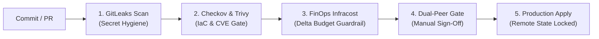

# 🛡️ Enterprise DevSecOps Golden Pipeline

**Standardized multi-cloud DevSecOps pipeline templates enforcing shift-left security (secrets, IaC compliance, container CVEs), FinOps cost caps, and dual-peer approval gates.**

[Threat Model](docs/threat-model.md) · [Operations Runbook](docs/operations-runbook.md) · [GitHub Actions](.github/workflows/golden-pipeline.yml) · [Azure DevOps YAML](azure-pipelines/azure-pipelines.yml)

---

## ⚡ Pipeline Stages & Flow

---

## 🚀 Quickstart & Usage

Include this pipeline in your microservice or IaC repositories by referencing the reusable workflow or copying `.github/workflows/golden-pipeline.yml`.

---

## 🤝 Maintained by
**Rushikesh Bonde** · Licensed under MIT.